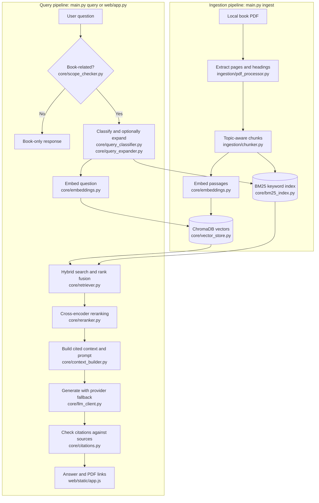

# habitRAG

Ask questions about *Atomic Habits* and trace answers back to the book. habitRAG is a local PDF question-answering app with topic-aware chunks, hybrid search, reranking, streamed answers, and clickable source pages.

## Features

- Extracts text and headings from the PDF, then splits long topics into smaller chunks that keep the same topic label.
- Searches both ChromaDB embeddings and a BM25 keyword index, then combines their results and reranks the best passages.
- Answers with Groq, then tries OpenRouter and Vercel AI Gateway when configured providers fail.
- Rejects clearly unrelated questions before searching the indexes.
- Shows cited PDF pages beside the chat. Conversation history and display preferences stay in the browser's local storage.

## Architecture



`ingestion/pipeline.py` coordinates the ingestion steps. `core/query_engine.py` coordinates question answering and streaming. ChromaDB, BM25, and a readable chunk snapshot are generated under `data/`.

## Get started on Windows

You need Python 3.11 or newer, Node.js for JavaScript tests, internet access for the first model downloads, and a legally obtained copy of the book PDF. Place the PDF in this folder as `Atomic Habits by James Clear.pdf.pdf`. The book is not included in this repository.

In PowerShell, from the project folder:

```powershell
py -3 -m venv venv
.\venv\Scripts\python.exe -m pip install -r requirements.txt
Copy-Item .env.example .env
```

Open `.env` and add at least one provider key. Keep that file private. Blank entries are skipped.

```text
GROQ_API_KEY=
OPENROUTER_API_KEY=
AI_GATEWAY_API_KEY=
```

Build both search indexes, then start the web app:

```powershell
.\venv\Scripts\python.exe main.py ingest
.\venv\Scripts\python.exe main.py serve
```

Visit [http://localhost:8000](http://localhost:8000). Keep the server terminal open. For a command-line question, run `.\venv\Scripts\python.exe main.py query "What is habit stacking?"`. After changing the PDF or chunk settings, rebuild with `.\venv\Scripts\python.exe main.py ingest --force`.

## Run checks

```powershell
.\venv\Scripts\python.exe -m pytest tests -q
.\venv\Scripts\python.exe -m pip install ruff
.\venv\Scripts\ruff.exe check core ingestion web tests main.py config.py
$jsTests = (Get-ChildItem .\tests -Filter '*.js').FullName
node --test $jsTests
```

## Privacy and project data

`.env`, the book PDF, virtual environments, model downloads, generated indexes, browser chat history, and local planning files are excluded from Git. `.env.example` contains only empty key fields. Anyone cloning this public repository must supply their own PDF and API key.

See [setup and troubleshooting](docs/SETUP.md) for provider details and [how it works](docs/HOW_IT_WORKS.md) for a longer walkthrough.
